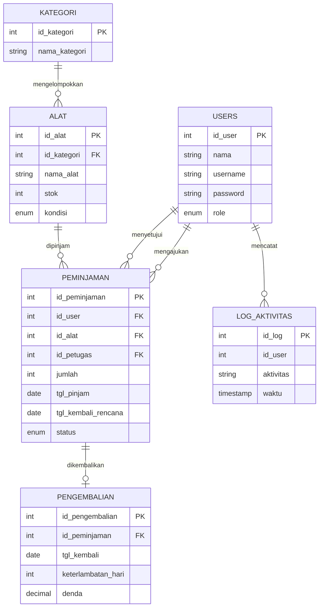
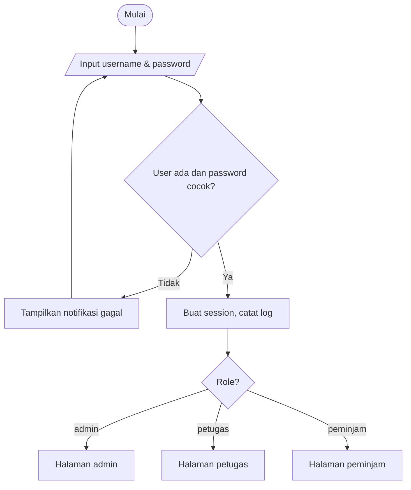
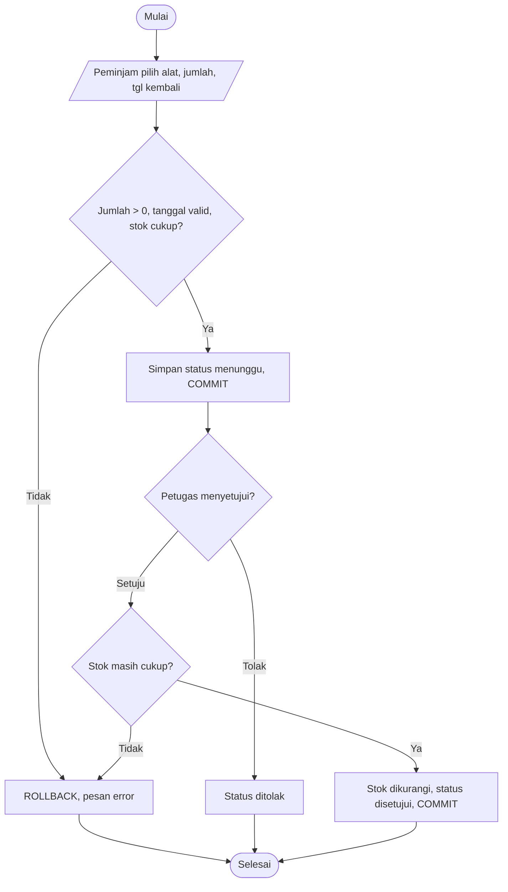
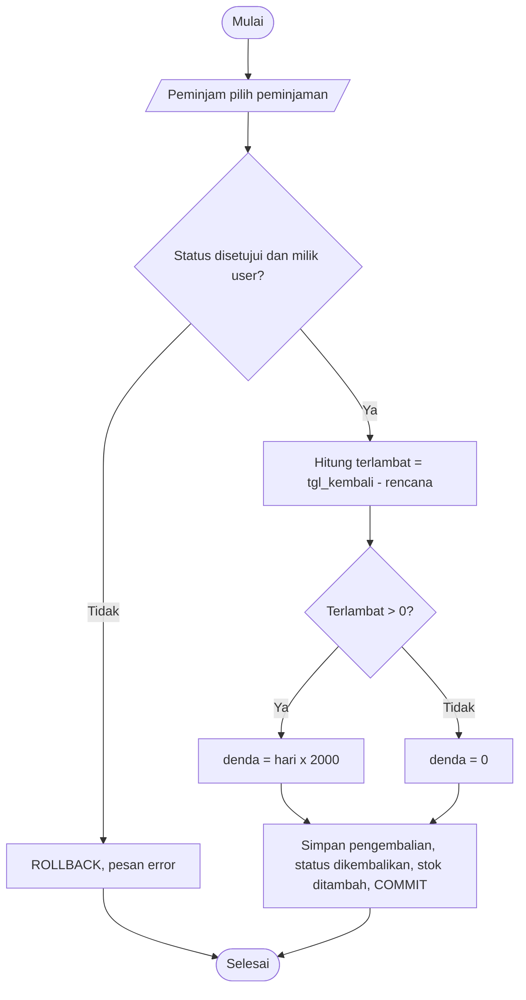

# 1. Analisis Kebutuhan dan Desain

## Metode
Waterfall sederhana: analisis kebutuhan, desain, implementasi, pengujian, dokumentasi.

## Analisis Kebutuhan
| Fitur | Admin | Petugas | Peminjam |
|---|:-:|:-:|:-:|
| Login / Logout | v | v | v |
| CRUD user, alat, kategori, peminjaman, pengembalian | v | | |
| Log aktivitas | v | | |
| Menyetujui peminjaman, memantau pengembalian, mencetak laporan | | v | |
| Melihat daftar alat, mengajukan peminjaman, mengembalikan alat | | | v |

Aturan bisnis: stok berkurang saat peminjaman disetujui dan bertambah saat dikembalikan. Denda Rp2.000 per hari keterlambatan.

## Struktur Data (tipe data lengkap ada di `database/peminjaman_alat.sql`)
| Tabel | Kolom utama |
|---|---|
| users | id_user (PK), nama, username (UNIQUE), password (hash), role ENUM |
| kategori | id_kategori (PK), nama_kategori |
| alat | id_alat (PK), id_kategori (FK), nama_alat, stok, kondisi, deskripsi |
| peminjaman | id_peminjaman (PK), id_user (FK), id_alat (FK), id_petugas (FK), jumlah, tgl_pinjam, tgl_kembali_rencana, status |
| pengembalian | id_pengembalian (PK), id_peminjaman (FK, UNIQUE), tgl_kembali, keterlambatan_hari, denda |
| log_aktivitas | id_log (PK), id_user, aktivitas, waktu |

## ERD (Mermaid; salin ke https://mermaid.live atau draw.io lalu ekspor PNG/JPG)


## Flowchart
### Login

### Peminjaman Alat

### Pengembalian dan Denda

Pseudocode pengembalian:
```
BEGIN TRANSACTION
ambil peminjaman WHERE id=? AND user=? FOR UPDATE
JIKA status != 'disetujui' MAKA ROLLBACK; error
terlambat = MAX(tgl_kembali - tgl_rencana, 0)
denda = terlambat * 2000
INSERT pengembalian; UPDATE peminjaman status; UPDATE alat stok += jumlah
COMMIT
```
